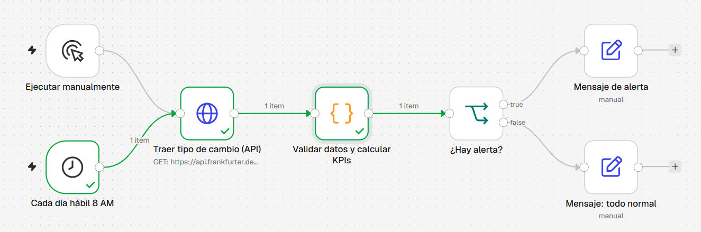

# USD/MXN Exchange Rate Monitor with Data Validation (n8n)

A small automation workflow built in [n8n](https://n8n.io) that pulls the last 30 days of USD/MXN exchange rates from a public REST API, validates the quality of the data, calculates summary KPIs (latest, average, min, max and % change), and applies a simple business rule to decide whether to raise an alert. This is a **learning/practice project**: my first n8n workflow, built to practice API integration, data validation and rule-based reporting. It is not a production system.



> Note: node names and output messages are in Spanish (my native language). The table below gives an English translation of each node.

## How it works

| # | Node (Spanish name) | n8n node type | What it does |
|---|---|---|---|
| 1 | **Ejecutar manualmente** (Run manually) | Manual Trigger | Starts the workflow on demand. |
| 2 | **Cada día hábil 8 AM** (Every weekday 8 AM) | Schedule Trigger | Cron `0 8 * * 1-5`, Mexico City time. Only runs if the workflow is activated. |
| 3 | **Traer tipo de cambio (API)** (Fetch exchange rate) | HTTP Request | `GET` request to the [Frankfurter API](https://frankfurter.dev) for daily USD→MXN rates over the last 30 days. Public API, no key needed. |
| 4 | **Validar datos y calcular KPIs** (Validate data and calculate KPIs) | Code (JavaScript) | Runs data quality checks, computes the KPIs and sets an `alerta` (alert) flag. |
| 5 | **¿Hay alerta?** (Is there an alert?) | IF | Routes to the *true* branch if `alerta` is true, otherwise to *false*. |
| 6 | **Mensaje de alerta** (Alert message) | Set (Edit Fields) | Builds the alert summary text. |
| 7 | **Mensaje: todo normal** (All normal message) | Set (Edit Fields) | Builds the "stable" summary text. |

### Data quality checks
Before calculating anything, the Code node checks that:
- the API actually returned data (not empty),
- every daily value exists and is numeric (no missing / non-numeric values),
- every value is positive,
- there are no duplicate dates.

Any issue is recorded in a `problemas_de_datos` (data problems) list, and invalid values are excluded from the KPIs.

### KPIs
- **Latest rate** (`ultimo_tipo_cambio`)
- **Average** (`promedio`)
- **Minimum** and **maximum**, with their dates (`minimo`, `maximo`)
- **% change** from the first to the last day of the period (`cambio_pct`)
- **Days with data** (`dias_con_dato`). The API only publishes rates on business days, so 30 calendar days give about 21 data points.

### Business rule
An alert is raised if **there is any data quality problem** *or* **the absolute % change over the period is greater than 1.5%**. The threshold is a single constant, `UMBRAL_PCT = 1.5`, in the Code node, so it is easy to adjust.

## Sample output
On a run on Oct 25, 2026 the rate moved about +6.1% over the period, so the workflow took the alert branch. The resulting message (in Spanish) was:

```text
ALERTA USD/MXN (2026-09-25 a 2026-10-23): el tipo de cambio se movió 6.12%. Último: 18.7823, promedio: 18.2557, mínimo: 17.6989 (2026-09-25), máximo: 18.7823 (2026-10-23). Problemas de datos: ninguno.
```

*English:* "USD/MXN ALERT (2026-09-25 to 2026-10-23): the exchange rate moved 6.12%. Latest: 18.7823, average: 18.2557, min: 17.6989 (2026-09-25), max: 18.7823 (2026-10-23). Data problems: none."

To test the rule, I raised the threshold to 10%. The same ~6% move then went to the **Mensaje: todo normal** branch, as expected.

## Tech used
- **n8n** (n8n Cloud): workflow automation
- **REST API / JSON**: [Frankfurter](https://frankfurter.dev) exchange rate API
- **JavaScript**: data validation and KPI logic in an n8n Code node

## How to run it
No credentials or API keys are needed.

1. Open n8n (an [n8n Cloud](https://n8n.io) trial or a self-hosted instance).
2. Create a new workflow, open the **⋯** menu (top right) and choose **Import from File**.
3. Select [`workflow/monitor_usd_mxn.json`](workflow/monitor_usd_mxn.json).
4. Click **Execute workflow**, then open each node to inspect its input and output.

The schedule trigger only runs if you activate/publish the workflow. Running it manually is enough to try it out.

## Possible next steps
- Send the message by **Gmail** or **Slack** instead of only building the text.
- Log each run's KPIs to **Google Sheets** to build a history and chart it (for example in Tableau).
- Compare more currencies (EUR, CAD) or use a moving average instead of first-vs-last change.
- Add error handling for API downtime.

## Repository structure
```
├── README.md
├── workflow/monitor_usd_mxn.json   # n8n workflow export (import this)
├── docs/GUIA_ES.md                 # short guide in Spanish
└── images/workflow.png             # screenshot of the workflow canvas
```

## Author
**Mario Zarza Zárraga**, Freelance Data Analyst
[LinkedIn](https://www.linkedin.com/in/mario-zarza-z%C3%A1rraga-26777729) · [Tableau Public dashboard](https://public.tableau.com/app/profile/mario.zarza/viz/AnlisisdeUsuariosyConsumo-Telecom/Dashboard1) · [GitHub](https://github.com/ZarzaZMario)
